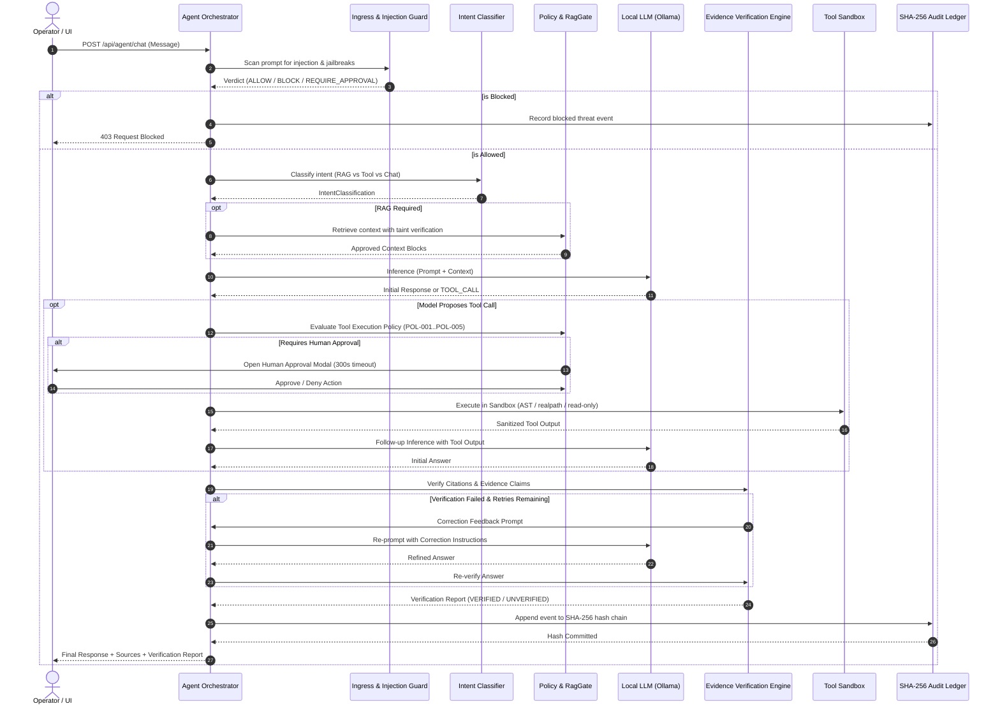

# Clarix AI — System Architecture Specification

## 1. Architectural Philosophy

Clarix AI is engineered around the principle of **Defense-in-Depth for Autonomous Agents**. Language models are treated as non-deterministic and untrusted computing elements. No security decision relies on model benevolence or system-prompt compliance. Instead, deterministic policy enforcement envelopes the model across the entire lifecycle:

```
Ingress Filter → Taint Origin Tracking → Knowledge Graph & Policy-Gated Retrieval → Local LLM → Tool Sandbox → Evidence Verification → Output Redaction → SHA-256 Audit Chain
```

---

## 2. Subsystem Breakdown

### 2.1 Ingress & Chat Interface
- **Operator Console**: React 18 + TypeScript + Vite web interface providing an integrated SOC dashboard and Agent console.
- **Session Management**: Each chat session maintains isolated state, tracking request traces, citations, and approval callbacks.
- **Self-Hosted Assets**: Fonts (`@fontsource/jetbrains-mono`, `@fontsource/sofia-sans`) and icons are bundled locally with zero CDN dependencies.

### 2.2 Section 1: Document Ingestion & Knowledge Vault
- **Multi-Format Document Parsing**:
  - `pypdf`: Extracts real page numbers and textual streams.
  - `python-docx`: Unpacks document XML, stripping styling while preserving paragraphs and tables.
  - `python-pptx`: Extracts text slide-by-slide, mapping slides to logical page locators.
  - `csv`: Structures tabular rows into key-value descriptions.
  - Plaintext & Markdown: Normalized UTF-8 decoding with form-feed page splitting.
- **Recursive Overlapping Chunking**: Target chunk size of 900 characters with 120-character overlap.
- **Indirect Prompt Injection Quarantine**: Chunks containing injection signatures are quarantined upon ingestion (`flagged = 1`), preventing them from appearing in retrieval results.
- **Local Knowledge Graph (`kg_entities`, `kg_relations`)**:
  - Automatically identifies policies, protocols, organizations, roles, and tools.
  - Infers relationships (`ENFORCES`, `USES`, `BLOCKS`, `CONTAINS`) based on textual proximity.
  - Facilitates entity subgraph extraction and graph-based context enrichment.
- **Dense Vector Embedding & Store**:
  - Packaged dense vectors stored as binary BLOBs in SQLite (`rag_chunks.embedding`).
  - Cosine similarity computed in Python with relative score thresholds (`RELATIVE_CUT = 0.5`).

### 2.3 Section 2: Agent & Orchestration Engine
- **Intent & Task Classification**: Classifies inbound prompts into `RAG_QUERY`, `TOOL_EXECUTION`, `SECURITY_ADMIN`, and `CONVERSATIONAL` before executing retrieval or tool planning.
- **Context Builder**: Combines system prompts, Knowledge Graph triplets, and policy-cleared `<document>` tags into an isolated context window.
- **Tool Protocol**:
  ```
  TOOL_CALL {"tool": "<name>", "input": "<argument>"}
  ```
  The agent loop evaluates tool calls step-by-step up to `MAX_TOOL_STEPS = 3`.

### 2.4 Section 3: Evidence Verification Engine
- **Claim Checker**: Isolates factual propositions from conversational filler and splits on sentence boundaries.
- **Source Checker**: Verifies `[n]` citation markers, bounds-checking against $1 \le n \le N$.
- **Evidence Checker**: Computes lexical overlap, verifies numeric/metric preservation, and evaluates support strength.
- **Verification Policy Checker**: Enforces coverage and confidence requirements based on document classification:
  - `RESTRICTED_STRICT`: 90% citation coverage, 0.40 min score, 0% unsupported.
  - `CONFIDENTIAL_STANDARD`: 70% citation coverage, 0.30 min score, max 15% unsupported.
  - `INTERNAL_LENIENT`: 50% citation coverage, 0.20 min score.
  - `PUBLIC_BASELINE`: 30% citation coverage.
- **Correction Feedback Loop**: Generates specific rewrite guidance and triggers re-prompting if verification fails. Emits `Unverified Response` warnings when retry limits are reached.

### 2.5 Section 4: AI Harness & Security Perimeter
- **Input Security Guard**: Screens character length, unicode anomalies, and control characters.
- **Prompt Injection Detector**: Multi-pattern regex analyzer checking delimiter escapes, role assumption, base64 obfuscation, leetspeak, and exfiltration attempts.
- **Tool Permission Manager**: Grants per-tool permission levels: `DISABLED`, `NORMAL`, `RESTRICTED`, `CRITICAL`.
- **Human Approval Gate**: Atomic compare-and-set approval requests on `status='PENDING'`, with 300-second expiration.
- **Execution Sandbox**: Realpath directory containment, AST expression evaluators, read-only SQLite authorizers, and restricted shell allowlists.
- **Taint Tracking & Data Leakage Prevention**: TaintContext tags propagate through operations (`PUBLIC`, `INTERNAL`, `CONFIDENTIAL`, `RESTRICTED`).
- **Tamper-Evident SHA-256 Audit Ledger**: SQLite triggers enforce append-only rules; hash chain recomputes canonical JSON across every event field.

### 2.6 Section 5: Response & Explanation
- **Final Response Generator**: Sanitizes output, strips `<think>` tokens, and redacts discovered secrets.
- **Attribution & Sources Drawer**: Attaches source snippets, locators, and verification metrics to the response payload.

### 2.7 Section 6: Local Infrastructure
- **Local Model Runtime**: Loopback-bound Ollama instance (`127.0.0.1:11434`).
- **Encrypted Local Storage**: AES-256 Fernet envelope encryption at rest for workspace documents and credentials.
- **Egress Guard**: In-process monkey-patching of `socket.connect`, `connect_ex`, `sendto`, `getaddrinfo`, and `gethostbyname` to reject non-loopback destinations.

---

## 3. Sequence Diagram: Protected Chat & Tool Execution


